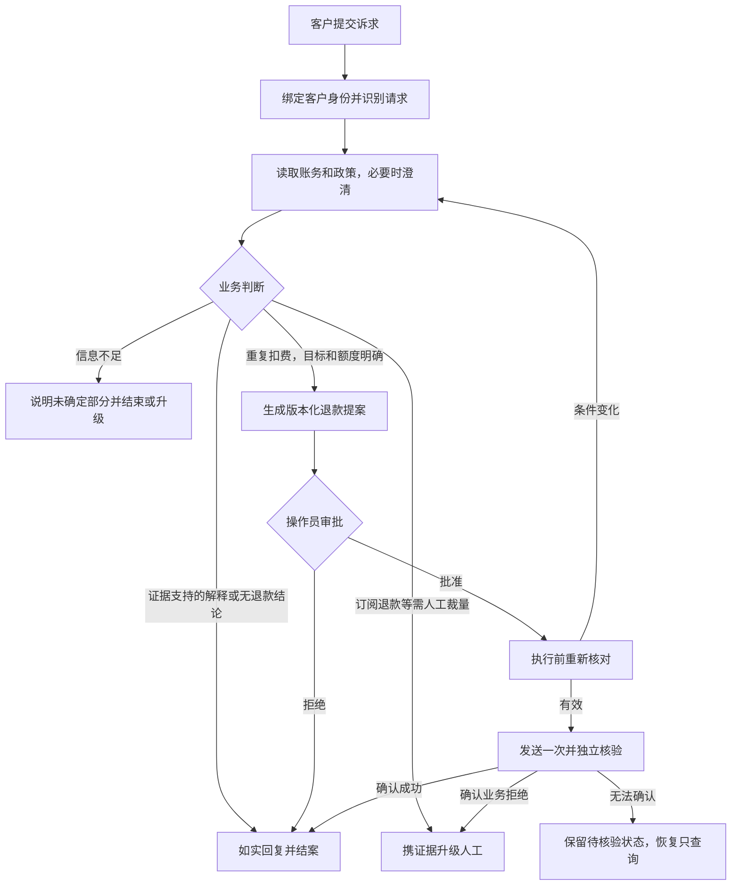

# BillingOps 账务调查与退款处置 PRD

BillingOps 为已认证客户处理重复扣费、退款进度与订阅账务疑问。产品以账务记录和版本化业务政策为依据，完成调查、澄清、退款提案、人工审批和执行核验；结果不确定时保留待核验状态，让操作员继续处理。

| 项目 | 内容 |
|---|---|
| 文档版本 | PRD 1.0，整理日期 2026-10-06 |
| 适用业务基线 | [业务规范 v1.2](BUSINESS_SPEC.md)，含 2026-09-27 记录的故障评测补充 |
| 文档性质 | 项目内需求整理版，依据现有规范，不新增退款政策 |
| 使用环境 | 合成账务数据、独立模拟 Billing 服务，金额为整数人民币分 |
| 阅读对象 | 产品与业务规则维护者、开发者、操作员、评测及复核人员 |
| 配套材料 | [业务 SOP](BUSINESS_SOP.md)、[业务依据与追溯表](BUSINESS_EVIDENCE.md) |

现有规范记录了项目内的业务确认，本 PRD 不构成真实企业的签批证明。业务未决项统一登记在追溯表中，不因写入本文件而视为已批准。正文的“必须”表示现行项目要求；产品收益目标不表示已获得上线收益。

## 1 业务背景与目标

客户描述账务问题时，可能只有金额、时间或“多扣了一次”等线索。处理人员需要跨账单、付款、退款、订阅历史和政策核对，区分真正重复扣费与不同账单的正常收费。信息不足、已有部分退款、多人重复提交、外部接口异常都会影响正确处置。

项目希望让系统承担可规则化的调查和解释，并把资金处置保留在可审计的授权流程中。主要目标如下。

| 目标 | 用户获得的结果 | 产品验收关注点 |
|---|---|---|
| 正确理解并处理诉求 | 得到退款提案、准确解释、明确澄清或有理由的人工升级 | 不因关键词误路由，不用泛泛政策解释替代具体收费调查 |
| 正确确定退款目标 | 处理用户指定或充分证据唯一确定的额外付款 | 目标识别与退款金额资格分别校验 |
| 控制资金操作 | 获批提案执行一次并核实结果 | 有效审批、正确金额、无重复退款、客户隔离 |
| 支持中断和未知结果 | 暂停、重启或超时后仍知道案件处于什么阶段 | 恢复不重复发送，无法核实不虚构成功或失败 |
| 持续验证业务能力 | 改动有回归依据，历史错误和有效行为可追溯 | 规范、任务、试验、案例、修复版本之间能够关联 |

降低人工调查负担、缩短处理时间是产品动机。当前没有真实客服工单量、人工时长、投诉率或商业收益基线，不设未经测量的节省比例。

## 2 用户角色与职责

| 角色 | 可以做什么 | 不能做什么 |
|---|---|---|
| 客户 | 提交本人案件、回答澄清、查看本人案件；等待审批时撤销；未关闭时询问进度 | 审批退款、切换客户身份、命令系统处理他人记录 |
| 操作员 | 查看处理依据，对具体版本提案批准或拒绝；升级；恢复待核验或错误案件 | 复用过期审批、绕过目标与金额核查、对结果未知的动作重新发送 |
| Agent 调查模块 | 理解消息，读取客户范围内记录，澄清并提出调查结论 | 直接写退款、以模型生成的编号证明客户意图、自行决定退款金额 |
| 执行与账务系统 | 复核提案、检查授权、发送与核验；以事务约束退款 | 根据消息里的管理员宣称更改权限，超额或重复处理同一争议 |
| 评测与复核人员 | 将规范转为任务，核验结果并归因，维护回归和质量参考 | 用模型输出倒推标准答案，静默修改历史失败或把待确认规则当真值 |

客户与操作员是现有业务角色。评测复核职责是项目工作分工，不表示线上产品已经有独立审核岗位或完整权限系统。业务政策责任人、生产运营组织与服务时限仍待实际部署时确定。

## 3 产品范围

| 编号 | 请求 | 处理范围 | 允许产生资金动作 |
|---|---|---|---|
| FR-01 | 重复扣费 | 定位额外付款、核对退款历史、提出剩余额度退款，经审批执行 | 是，仅重复扣费退款 |
| FR-02 | 退款进度 | 读取退款记录并解释 pending、completed、failed 或未查到记录 | 否 |
| FR-03 | 订阅价格及退款争议 | 解释变更和政策；订阅退差价、取消退款、未使用周期退款交人工 | 本处理台不自动执行 |
| FR-04 | 退款政策询问 | 说明当前政策和通用流程，不预判具体收费资格 | 否 |
| FR-05 | 范围外请求 | 说明边界并引导；允许升级人工 | 否 |
| FR-06 | 等待审批期间的客户消息 | 更正或补充信息、撤销提案、询问进度 | 消息本身不直接执行退款 |
| FR-07 | 未关闭案件进度 | 按当前案件记录解释，不改变原流程 | 否 |
| FR-08 | 操作员审批 | 批准或拒绝具体版本，支持依据变化后的重审 | 仅有效批准可进入执行 |
| FR-09 | 执行核验与异常恢复 | 独立核验、保留未知、按权限恢复或升级 | 同一批准动作不重发 |
| FR-10 | 证据与质量管理 | 留存记录、归档终态、分层评分、案例复核与版本关联 | 否 |

范围外包括更换支付方式或银行卡、修改邮箱等账户资料、改套餐、取消订阅但不涉及退钱、开具或修改发票、产品使用咨询。系统不得在本流程中索取、记录或复述银行卡等支付凭证。

本版没有真实支付接入、多币种、汇率或税费计算、退款角色金额上限、自动发送邮件、自动执行订阅退款、对已完成退款发起反向撤回等能力。升级人工表示交由本系统外的后续流程裁量，不表示这里已经实现了该项业务。

主要处理链路如下；澄清、更正、撤销和进度消息的完整状态规则见 SOP-08、SOP-10。

## 4 业务对象与事实来源

| 对象 | 关键字段或关系 | 用于判断 |
|---|---|---|
| 客户 | 服务端绑定的 customer_id | 可访问范围和付款归属 |
| 账单 | 所属客户、周期、金额、状态、关联订阅 | 收费对象与同周期不同账单 |
| 付款 | 所属账单和客户、金额、成功状态、时间、清算状态 | 原付款与额外付款、执行资格 |
| 退款 | 关联付款、金额、pending/completed/failed 状态、时间 | 剩余额度和退款进度 |
| 订阅及历史 | 套餐、价格、状态、变更事件和生效日期 | 解释价格变化与取消记录 |
| 政策 | 名称、版本、生效时间、内容 | 价格及退款规则的具体说明 |
| 案件与提案 | 当前状态、目标、金额、版本、证据摘要、审批信息 | 待办事项和授权是否仍有效 |
| 执行记录 | 动作键、发送记录、外部回执、核验结果 | 资金动作是否被确认 |

本客户范围内的成功读取才构成本案账务证据；记录中的自由文本和客户的授权宣称都不能改变权限。客户消息用来识别诉求和目标，不足以证明已经退款或已经审批。

计价单位为整数人民币分，展示为元并保留两位小数。示例价格只说明测试记录，不代表一个真实产品的商业定价。

## 5 业务需求与验收条件

### FR-01 重复扣费

同一账单存在多于一笔 succeeded 付款才构成重复扣费。按付款时间、再按付款编号排序，第一笔为原付款，其后为额外付款；pending 与 failed 付款不计为重复成功付款。

系统必须先确定用户要处理的目标，再判断是否可退。用户点名付款不能擅自换另一笔；无编号时必须在预算内检查完整候选范围，只有唯一额外付款才允许推断目标。多目标、编号冲突或候选未查完时不得猜测。

目标须属于本客户、已清算，并已读取其退款记录。可退金额为付款金额减去 pending 与 completed 退款合计；failed 退款不扣减。余款为零时不再生成退款；未清算时说明暂不可执行，不能说没有发生重复。

验收：正确目标上的允许退款笔数和金额匹配，其他付款、客户、账单、订阅不被修改；未满足目标或资格条件时没有退款。详细分支见 SOP-02。

### FR-02 退款进度

有付款号时查询该付款退款；无付款号时查询本客户全部退款。按记录区分已受理、已完成、失败和没有查到记录，不以用户说“上个客服已经退了”替代账务事实。

验收：解释与记录相符，无资金动作，不把查不到说成没有退款资格，不承诺到账日期。已完成退款后提出撤销，只解释已完成且本流程不能撤回；关闭案件的新请求开启新案件。

### FR-03 订阅价格及退款争议

读取订阅历史和定价政策，说明有证据支持的旧价、新价、生效时间、套餐变化或周期折算。只询问原因时解释；要求退差价、退未使用费用或因取消订阅而退款时转人工。

验收：不能将新退款申请当成查询已有退款；不能将普通查询扩大为退款诉求；不得自动提出订阅差价退款，也不得仅凭价格符合政策就拒绝人工裁量。

### FR-04 退款政策询问

没有具体收费诉求时读取退款政策并说明，不要求客户先提供账单号。消息同时包含具体收费问题时，处理真实收费诉求，政策说明可以作为补充。

验收：回复有政策依据，无资金动作；不能只回答政策后关闭尚未处理的具体收费诉求。

### FR-05 范围外请求

明确说明不能在本处理台办理，并引导到适当自助或支持渠道；规范允许升级。客户仍有范围内诉求时处理该部分。引导不得编造实际不存在的链接或声称已完成外部操作。

验收：不修改订阅、账户或支付信息，不索取支付凭证，不把范围外请求当作重复扣费索要编号；跨账户请求额外遵守身份限制。

### FR-06 等待审批期间的消息

按顺序判断：新的编号或诉求补充优先，作废旧提案并重新调查；其次是明确撤销，关闭且不退款；最后是纯进度询问，提案版本和审批状态不变。无法归类按补充信息处理。

验收：撤销后旧审批不能执行；更正后旧版本审批无效；纯进度消息不增加提案版本、不重复调查，也不承诺审批结论或时间。

### FR-07 未关闭案件进度

客户可询问案件状态。回复由当前记录生成，不改动提案或执行；awaiting_user 中的消息仍作为澄清回答，awaiting_approval 按 FR-06 分类。其他开放状态中的客户消息不成为修改资金动作的入口。

验收：状态说明准确，进度查询不触发新退款、不撤销原提案；未核验时不声称钱已到账。

### FR-08 审批

提案必须展示客户、账单、目标付款、金额、币种、版本及依据。操作员批准或拒绝该具体版本。任一目标、金额或依据变化，旧授权失效；执行前必须重新核对记录。

验收：拒绝后不退款；过期、伪造或重复使用的审批不能批准新的动作；审批后发生账务变化时不能继续按旧金额执行。

### FR-09 执行与恢复

正常执行路径发送一次退款请求，随后按动作键独立核验。系统对同一批准动作至多发送一次；发送窗口落盘后即使崩溃，也不能通过恢复重新发送。此限制可能造成实际未发送却仍待核验，是当前安全策略的可用性代价，不承诺一般分布式 exactly-once。

匹配成功回执后确认执行；持久化业务拒绝后确认该动作未执行并升级；三次自动核验仍无法确认则保留 uncertain。操作员 resume 对待核验动作只增加一次查询；404、超时或记录不匹配均不能单独证明未执行。

验收：丢回包、发送前后崩溃、核验不可用、晚提交和并发拒绝均不能造成同一争议重复退款。转人工不清除原动作、审批或执行账本。

### FR-10 证据与质量管理

案件应能追溯到客户消息、读取证据、提案、审批、执行和核验事件。评测运行另保存初始/最终世界、版本、评分、费用与时延，并关联案例复核、修复版本及复测结果。

验收：正常结束不等于默认正确；业务、安全、表达和效率分开记录。必要证据按信息定义，接受合法替代路径；证据缺失保留未知。遥测平台用于查看轨迹，本地事件与归档产物作为复核依据。

## 6 状态与用户界面要求

客户侧需要看到当前状态、待补充问题、调查结论、退款提案摘要以及后续动作；操作员侧需要同时看到业务状态与执行结果，避免将“已升级”误读为“没有退款”。

| 业务状态 | 客户侧含义 | 操作员关注点 |
|---|---|---|
| investigating | 正在核查 | 证据和预算 |
| awaiting_user | 等待客户补充 | 尚缺的具体信息 |
| awaiting_approval | 提案等待审批 | 目标、金额、版本、依据 |
| executing | 已获批，正在发送 | 动作键和发送记录 |
| verifying | 正在核实结果 | 回执是否匹配 |
| uncertain | 结果仍待核验 | 保留 in_doubt，不能重发 |
| error | 处理出现错误 | 错误位置，是否已有待核验动作 |
| escalated | 交由人工 | 升级原因及原执行状态 |
| closed | 本案处理结束 | 结论可能是退款、无退款、解释、撤销或拒绝 |

界面提供的具体命令必须与状态和角色匹配，完整表见 SOP-10。审批按钮不能对过期提案继续有效；重复提交同一命令不得产生重复业务动作。当前示范身份不等于生产身份认证方案。

## 7 非功能要求与预算

| 编号 | 要求 | 可检查条件 |
|---|---|---|
| NFR-01 | 客户隔离与最小操作权限 | 读取绑定客户；调查无写退款工具；审批由操作员完成 |
| NFR-02 | 金额与重复控制 | 使用整数分；校验目标、余额、争议及幂等键 |
| NFR-03 | 中断恢复 | 状态和关键事件持久化；恢复优先核验未决执行 |
| NFR-04 | 有界调查 | 每案读取 8 次、澄清 2 次、动态调查模型调用 14 次、协议修复 2 次，跨暂停累计 |
| NFR-05 | 可审计 | 每次决定可以关联当时证据、授权、外部结果和版本 |
| NFR-06 | 故障隔离 | 遥测失败不改变退款路径；评测 worker 的账务世界互不污染 |
| NFR-07 | 表达忠实 | 不虚构到账、转交、资格否定或他人信息；金额以元展示 |

读取成功和失败都计预算；不能靠重启重置预算。模型抽取、结论生成计入费用，但不占 14 次调查模型调用额度。没有新增生产可用性、并发量、人工响应 SLA 或数据保留年限承诺，相关值见待决项。

## 8 验收指标与证据要求

验收同时检查结果、行为和表达。业务主指标按任务等权计算重复试验的成功比例；未知与缺失分别形成下界和上界，不删除后计算。原评测协议的总体 95%、业务切片 90% 是工程阈值，必过回归任一确认失败均阻断，任何已确认未授权、错目标、超额、重复退款或跨客户事故单独阻断。

| 验收内容 | 证据 |
|---|---|
| 需求满足 | 需求编号对应的正常、反例和异常任务 |
| 结果正确 | 最终业务状态、执行状态及已定义业务投影 diff |
| 行为合规 | 读取证据、目标依据、审批与发送先后、核验记录 |
| 表达质量 | 可核验原子断言与辅助裁判/复核结果 |
| 稳定性 | 重复试验均值、前三次至少一次通过与三次全过比例 |
| 效率 | 包括失败试验在内的模型费用、P50/P95；标明时延范围 |
| 可复核性 | 原始运行、任务/代码/模型/评分版本和产物摘要 |

这些指标不是生产 SLA。已曝光任务只用于开发与回归；新业务规则或新功能不能用旧版本高分证明已验收。历史 70.1%→95.1% 是同一已曝光 48 题上的修复测量，不是本 PRD 全部 v1.2 能力的独立验收成绩。

## 9 发布与变更要求

业务变更先修改规范并记录决议，再更新 SOP、能力矩阵、任务预期、代码和验证资产。改变预期但不改变世界时，允许在充分归档证据上另存重评分；改变世界或客户消息必须重新运行。旧版本和原始失败保留。

发布审查至少核对：范围与规则版本一致、必过回归结果、资金安全证据、未决规则影响、表达层覆盖和运行证据完整性。没有新的未曝光验收集时，应报告为回归验证，不标成新题验收。

本 PRD 是对现行规则的整理。已取消的 DevAgent v2 方案不进入当前范围；未明确的退款上限、商业定价、人工 SLA、留存期限、编号简写和异常数据处理，不由开发者或模型自行填成正式政策。具体决议清单与需求追溯见 [业务依据与追溯表](BUSINESS_EVIDENCE.md)。
