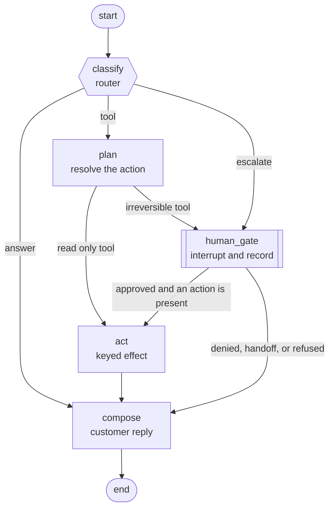

# langgraph-production

[](https://github.com/vinimabreu/langgraph-production/actions/workflows/ci.yml)
[](https://github.com/vinimabreu/langgraph-production/blob/main/pyproject.toml)
[](https://github.com/vinimabreu/langgraph-production/blob/main/LICENSE)

A LangGraph agent with the reliability layer that decides whether it can ship.


Building the graph is the easy half. The half that decides whether it goes live
is everything around it: what happens when the process dies between two nodes,
whether the refund gets paid twice on the way back up, whether an approval
somebody gave on Tuesday can authorise a different action on Thursday, and
whether anyone can say out loud how often the router is right.

This repo answers those four questions with code and with numbers, on a support
desk for a fictional product. All data is synthetic.

## The report this repo exists to produce

Real output from `python -m langgraph_production.evaluation` on this
repository, not an illustration:

```
========================================================================
SUPPORT GRAPH EVALUATION
========================================================================
  fixtures      answer 13, escalate 15, tool 23  (total 51)

ROUTING
  accuracy      46/51 = 90.2%
  macro F1      0.907
  tool choice   22/23 correct (95.7%) on tickets that should call a tool
  tool call     21/23 correct (91.3%) counting the arguments, not just the name

  confusion matrix (rows expected, columns predicted)
                   answer      tool  escalate
  answer              10         0         3
  tool                 1        22         0
  escalate             0         0        15

  per branch
    answer     support  13   precision 0.909   recall 0.769   f1 0.833
    tool       support  23   precision 1.000   recall 0.957   f1 0.978
    escalate   support  15   precision 0.833   recall 1.000   f1 0.909

  mistakes (5)
    TCK-009  answer -> escalate
      Can two workspaces share a single billing account?
      label rationale: billing vocabulary, but it is a capability question with no record attached
    TCK-017  tool -> answer
      Was INV-10120 issued before or after our plan change?
      label rationale: invoice lookup phrased without any billing vocabulary
    TCK-042  answer -> escalate
      Do refunds usually take five business days to appear?
      label rationale: asks about refund policy, does not request a refund
    TCK-043  answer -> escalate
      If I cancel the subscription mid term, do I lose historical data?
      label rationale: hypothetical, nothing is being cancelled
    TCK-051  tool: wrong arguments
      We were charged $90.00 on INV-10032 but only $45.00 of that was valid. Refund the difference.
      expected issue_refund(amount_cents=4500, invoice_ref=INV-10032)
      proposed issue_refund(amount_cents=9000, invoice_ref=INV-10032)
      label rationale: the amount is the difference the customer asks for, not the first figure in the message

INTERRUPTS
  correct       48/51
  must stop     25 tickets, missed 0 (miss rate 0.0%)
  must not stop 26 tickets, stopped 3 (fatigue rate 11.5%)
  stopped when it did not need to
    TCK-009  Can two workspaces share a single billing account?
      label rationale: billing vocabulary, but it is a capability question with no record attached
    TCK-042  Do refunds usually take five business days to appear?
      label rationale: asks about refund policy, does not request a refund
    TCK-043  If I cancel the subscription mid term, do I lose historical data?
      label rationale: hypothetical, nothing is being cancelled

RESUME
  scenarios     16
  boundaries    136 reached of 208 swept (65.4%)
  deterministic 112 identical final state, effect count unchanged (82.4% of reached)
  in doubt      24 stopped and refused to guess (17.6% of reached)
  mismatches    0
  duplicates    0
  in doubt windows act:claimed, act:executed, act:recorded
  handler runs the ledger can prove across those: 8 (work done whose receipt was lost, never work repeated)

------------------------------------------------------------------------
GATE: pass
------------------------------------------------------------------------
```

`TCK-051` is in there on purpose. The stand-in reads the first figure in the
message and proposes to refund ninety dollars where the customer asked for the
difference. It picks the right tool, so every metric that stops at the tool
name scores it a clean pass. A metric that never fires is not evidence of
anything, and the one that catches this is the reason `tool call` is a
separate line.

CI runs that command on every push. Exit code 1 when any threshold in
[`evals/thresholds.json`](evals/thresholds.json) is breached, and the build
goes red.

**Read the numbers honestly.** The routing figures measure the offline
stand-in that ships with this repo, a deterministic keyword classifier, against
fixtures written by the same author. That pairing is not evidence about any
vendor's model, and 90.2% is not a claim about anything but this pair. The
deliverable is the harness: it produces a number, it explains every mistake it
made, and it fails a build when the number moves. Swap the stand-in for
`from_chat_model(your_model)` and the same harness measures that instead, with
the same output and the same gate.

## Four things it proves

### 1. The gate is not optional

Three of the six tools are irreversible: `issue_refund`,
`cancel_subscription`, `reset_credentials`. Irreversibility is a flag on the
tool, and the routing edge reads that flag. There is no phrasing of a ticket,
and no wording a model can emit, that reaches a handler for one of those tools
without the graph first stopping and asking a human.

That is not asserted in prose. It is a parametrised test over the registry: for
every irreversible tool, drive a ticket that selects it and assert the run came
back asking for approval with zero handler executions recorded.

### 2. Approvals are single use

The gate mints a token from the thread, the ticket, the action id, and a digest
of the decision-relevant state. Change the amount and the token changes. Move
to another conversation and the token changes. A durable ledger binds each
token to the fingerprint of the decision it authorised.

The tricky part is that LangGraph re-executes an interrupted node from the top
when it resumes, so the same approval is legitimately presented more than once.
The ledger tells a resume apart from a reuse by comparing decision
fingerprints, not just tokens: an identical decision replayed is honoured, and
a different approver, a different verdict, or a different reviewer note under
the same token is refused. Every presentation is appended to the ledger, first
use or replay, so the audit trail shows which one happened.

Nothing here needs an id copied between systems or a policy file edited by
hand. The approval happens inside the same flow that raised it.

### 3. Effects happen once, and the windows that cannot be closed say so

`INSERT OR IGNORE` then read. The claim and the check are one statement, so two
attempts cannot both believe they are first.

Scope, stated plainly because it matters: that holds across separate processes
and across threads that each hold their own store. `SupportRuntime` shares one
SQLite connection across its stores, so a single runtime is meant to drive one
graph at a time. Run one runtime per worker rather than sharing one across
threads. Making the stores safe to share is a real piece of work and it is not
in this repo.

The key is built from the thread, the ticket, the tool, and the arguments
**after the tool's own schema has parsed them**. That last part is not a
detail. Nothing stops a model from writing `4500` on one attempt and `"4500"`
on the next, and a key built from the raw JSON would call those two different
refunds and pay both.

The claim is taken **before** the handler runs, which makes this at-most-once
rather than at-least-once. For a refund that is the right way round. It leaves
the stretch between the claim and the receipt open, and this repo does not
pretend otherwise. Three windows sit in there and all three are swept:

| Window | What a resume can prove | What it says |
| --- | --- | --- |
| `act:claimed` | the key is taken, no execution recorded | in doubt, the handler *may* have run |
| `act:executed` | the handler returned, the row never landed | in doubt, and the ledger cannot tell it from the row above |
| `act:recorded` | the execution row is on disk, the receipt is not | in doubt, and the work definitely happened |

Every handler run is appended to an `effect_executions` table that no crash can
roll back, so "exactly once" is measured rather than asserted, and so the third
row above can be told from the first.

A handler that *refuses*, meanwhile, is not in doubt at all. A well formed
reference to an invoice that does not exist gets past the schema and the human
and is turned down by the handler. That closes the key as failed. Leaving it
pending would turn a definite no into a permanent maybe, and the ticket would
never move again.

### 3b. In doubt is a queue, not a dead end

Stopping and refusing to guess is only half the job. The other half is being
able to answer.

```
$ python -m langgraph_production.reconcile --db state.sqlite3
open effect claims: 1
  demo-TCK-023:1270c45d1612d5d1
    tool        issue_refund
    status      pending
    claimed at  2026-01-01T00:00:00+00:00
    executions  0 recorded on disk

$ python -m langgraph_production.reconcile --db state.sqlite3 \
    --key demo-TCK-023:1270c45d1612d5d1 --outcome not_performed --resolver ops.dana
demo-TCK-023:1270c45d1612d5d1 resolved as not_performed by ops.dana
{
  "executions": 0,
  "key": "demo-TCK-023:1270c45d1612d5d1",
  "reconciled_at": "2026-08-04T19:16:03.472985+00:00",
  "reconciled_by": "ops.dana",
  "status": "released"
}
the claim is released: the next run of this ticket will call the handler
```

`--outcome performed` is the other direction: the key is closed with the
receipt the downstream system reports, and the next run replays it instead of
calling the handler. Either way the resolution is signed, and releasing a claim
never rewrites the executions table, which stays the record of what actually
ran.

### 4. It resumes from disk, deterministically

Checkpoints are written with `durability="sync"`. The evaluation harness kills
the run at every named boundary, brings it back on a **new runtime with new
connections**, and compares the final state to a clean baseline. One field is
allowed to differ, `receipt.replayed`, whose entire job is to record that a
resume happened. The harness reports that field rather than hiding it.

The gate does not only check that the sweep found nothing wrong. A sweep whose
boundaries all read `not_reached`, or one where every resume ended in doubt,
finds nothing wrong either, and both used to pass. How much of the sweep landed
on a real boundary, how much of that came back identical, and how much gave up
are three thresholds in the same file as the routing ones.

The same ticket, killed right after the money moved:

```
TICKET TCK-023 (pro)
  Please refund $45.00 from invoice INV-10032, we were double charged.

  crash injected at act:after_effect

  GATE (approval)
    token      cf76715eb240e608231301960277909e
    state      ab2f4abd3eae40348c344c2d5b60ec2c
    action     issue_refund(amount_cents=4500, invoice_ref=INV-10032)
    action id  1270c45d1612d5d1
    question   Approve issue_refund(amount_cents=4500, invoice_ref=INV-10032)? This cannot be undone.
    decision   approve by ops.dana

  PATH       classify -> plan -> human_gate -> act -> compose
  OUTCOME    acted
  CRASHES    1 (resumed from the checkpoint on disk)
  ROUTE      tool at confidence 0.88
  EFFECT     issue_refund key demo-TCK-023:1270c45d1612d5d1
             result {"invoice_ref": "INV-10032", "refunded_cents": 4500, "remaining_cents": 4500}
             replayed from the store: True

  REPLY      Done. We ran issue_refund on your account and the result is {"invoice_ref": "INV-10032", "refunded_cents": 4500, "remaining_cents": 4500}. Approved by ops.dana.

  handler executions recorded on disk: 1
  approval tokens consumed:            1
```

Without `--crash-at` the same command prints an identical path, an identical
result, and `replayed from the store: False`. One refund either way.

## The graph



[`tests/test_graph_structure.py`](tests/test_graph_structure.py) parses that
block out of this file and asserts it against the compiled graph: every node,
every edge, and which edges are conditional. Editing the diagram without
editing the graph fails the suite, and so does the reverse. The only names the
test translates are the `START` and `STOP` boxes, which LangGraph calls
`__start__` and `__end__`.

| Node | What it does | Can it cause a side effect |
| --- | --- | --- |
| `classify` | one model call, strict parse, decision written to state | no |
| `plan` | resolves the tool call into an action with a stable id | no |
| `human_gate` | mints a token, interrupts, validates and records the decision | no |
| `act` | claims the idempotency key, runs the handler, writes the receipt | yes, once |
| `compose` | one model call to draft the reply from the outcome | no |

## The router refuses to guess

Nine named ways the model output can fail to earn trust, each escalating to a
human with the reason recorded in state:

`empty_output`, `invalid_json`, `not_an_object`, `unknown_route`,
`missing_tool`, `unknown_tool`, `invalid_tool_args`, `invalid_confidence`,
`low_confidence`.

Argument schemas are strict, which is what turns a hallucinated identifier into
a caught error instead of a failed API call. A model that answers
`{"route": "tool", "tool": "issue_refund", "args": {"invoice_ref": "the may invoice", "amount_cents": 4500}}`
does not reach the refund handler: the pattern rejects the reference and the
ticket goes to a human. The parser never raises whatever it is handed, string
or not, and every one of the nine has a test.

What the schema cannot catch is a plausible argument that is simply wrong.
`INV-10032` exists, `9000` is a legal amount, and refunding ninety dollars when
the customer asked for the difference passes every check in this section. That
one is caught by the evaluation harness scoring the arguments, not by the
parser, which is why `expected_args` is part of every tool label.

## Approval fatigue is counted as a failure

A stop that was not needed is not caution, it is a cost. Teams call it caution
for about two weeks, then the queue fills with approvals that never mattered,
reviewers start clicking approve without reading, and the gate protecting the
irreversible action is protecting nothing.

So the harness reports both directions separately and gates them differently:

- **missed stops**: threshold `0.0`. Not a metric to trade off.
- **spurious stops**: threshold `0.15`. A real cost, a recoverable one, and a
  budget nobody has to lie about.

On the shipped fixtures the stand-in misses zero required stops and raises
three unnecessary ones, all three visible in the report above with the ticket
text and the reason the label says what it says.

## Install and run

```bash
pip install -e ".[dev]"

# the full gate, roughly four seconds
python -m langgraph_production.evaluation

# routing and interrupts only, skipping the crash sweep
python -m langgraph_production.evaluation --skip-resume

# a report a build can archive
python -m langgraph_production.evaluation --json runs/report.json

# one ticket, end to end
python -m langgraph_production --fixture TCK-023

# the same ticket, killed at a boundary and resumed
python -m langgraph_production --fixture TCK-023 --crash-at act:after_effect

# deny at the gate instead
python -m langgraph_production --fixture TCK-023 --deny

# keep the store, then look at what a crash left open
python -m langgraph_production --fixture TCK-023 --crash-at act:claimed --db state.sqlite3
python -m langgraph_production.reconcile --db state.sqlite3

pytest
```

Docker, which runs the gate as its default command:

```bash
docker build -t langgraph-production .
docker run --rm langgraph-production
```

## Using it with a real model

The graph never imports a provider SDK. It takes a callable:

```python
from langgraph_production import SupportRuntime, Ticket, from_chat_model

runtime = SupportRuntime(
    llm=from_chat_model(your_chat_model),   # any LangChain chat model
    db_path="state.sqlite3",                # checkpoints, effects, approvals
)

result = runtime.start(Ticket(id="T-1", text="Please refund $45.00 from INV-10032"), "thread-1")
if result.status == "awaiting_human":
    result = runtime.resume_with_decision("thread-1", your_reviewer_decision(result.gate))
```

To keep a real run reproducible afterwards, wrap the callable in a cassette:

```python
from langgraph_production.llm import Cassette, recording, replaying

live = recording(from_chat_model(model), Cassette("cassettes/run.json"))
offline = replaying(Cassette("cassettes/run.json"))   # a miss raises, it never calls out
```

No cassette is committed here, because no paid call was made to record one. The
record and replay paths are tested against fakes.

## Design notes worth arguing with

- **The state holds plain JSON, not pydantic instances.** A checkpoint written
  today has to be readable by a build shipped six months from now. Pydantic
  models are the validation layer at node boundaries; typed accessors in
  `state.py` are the only sanctioned way to read a structured field back out.
- **`durability="sync"`.** LangGraph's default is faster and fine for chat. It
  is the wrong default for a graph that can move money, because the window
  where a node has run and its checkpoint has not landed is exactly the window
  this repo exists to close.
- **One SQLite file for checkpoints, effect claims, and approvals.** Losing one
  and keeping the other two would be worse than losing all three.
- **The idempotency key is the thread plus the parsed action.** The thread
  half means the same ticket driven on two threads really is two refunds. The
  action half is derived from the arguments *after* the tool's schema has
  parsed them, so `4500`, `"4500"` and `4500.0` are one key and one payment.
  Both halves have a test.
- **Time is injected.** A determinism check that has to make allowances for
  timestamps is not checking determinism.

## Test suite

373 tests, no network, no API key, no wall-clock sleeps.

```
============================= test session starts ==============================
platform darwin -- Python 3.14.6, pytest-9.1.1, pluggy-1.6.0
rootdir: /path/to/langgraph-production
configfile: pyproject.toml
testpaths: tests
collected 373 items

tests/test_approvals.py ...............................                  [  8%]
tests/test_cli.py ..............                                         [ 12%]
tests/test_crash_resume.py .......................................       [ 22%]
tests/test_effects.py ..................................                 [ 31%]
tests/test_evaluation.py ............................................... [ 44%]
............                                                             [ 47%]
tests/test_graph_routes.py ........................                      [ 53%]
tests/test_graph_structure.py ...........                                [ 56%]
tests/test_human_gate.py ............                                    [ 60%]
tests/test_llm_seams.py .................                                [ 64%]
tests/test_models.py .................                                   [ 69%]
tests/test_offline_llm.py ...............                                [ 73%]
tests/test_reconcile.py ...............................                  [ 81%]
tests/test_router_parsing.py ..................................          [ 90%]
tests/test_runtime.py .............                                      [ 94%]
tests/test_tools.py ......................                               [100%]

============================= 373 passed in 5.16s ==============================
```

What they cover:

| Area | File | Notable |
| --- | --- | --- |
| Router parsing | `test_router_parsing.py` | all nine refusal reasons, and output that is not even a string |
| Tools | `test_tools.py` | strict schemas, irreversible flags, invented identifiers |
| Domain models | `test_models.py` | one action id for three spellings of the same amount |
| Graph shape | `test_graph_structure.py` | the README diagram parsed and asserted against the compiled graph |
| Graph behaviour | `test_graph_routes.py` | every irreversible tool gated, one refund paid once across spellings |
| Human gate | `test_human_gate.py` | stolen token, forged token, malformed payload, unknown verdict |
| Approvals | `test_approvals.py` | both ledger backends, replay versus reuse, the note as part of the decision |
| Effects | `test_effects.py` | both stores, ten calls one execution, all three in-doubt windows |
| Reconciliation | `test_reconcile.py` | handler refusals, both resolutions, the CLI |
| Crash and resume | `test_crash_resume.py` | every boundary, twice over, state equality and execution count |
| LLM seams | `test_llm_seams.py` | cassette record, replay, strict miss; adapter against a real LangChain fake |
| Harness | `test_evaluation.py` | rigged models with known error counts, plus two degraded sweeps that must fail the gate |
| CLIs | `test_cli.py` | exit codes, JSON output, the crash demo, no litter left behind |

The output above is a local run on Python 3.14. CI runs the suite and the gate
on 3.11, 3.12, 3.13 and 3.14. The Docker image is built from `python:3.12-slim`
and was built and run for this README: `docker run --rm langgraph-production`
prints a passing report and exits 0.

## What this repo does not do

- No production deployment behind it. It is a reference implementation with a
  test suite, not a service anyone is being paged about.
- No live model call has been made from this code. The recording path exists
  and is tested against fakes; every number here comes from the offline
  stand-in.
- No Postgres checkpointer. SQLite is what the durability story is written and
  tested against.
- The synthetic dataset is small on purpose. The subject is control flow around
  tools, not any particular backend.

## Licence

MIT. See [LICENSE](LICENSE).

Vinicius Pereira
vinimabreu.dev · github.com/vinimabreu
